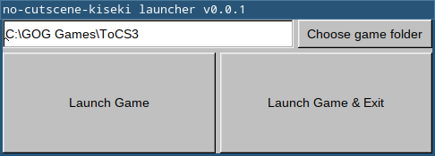

no cutscene kiseki
==================

This is a mod for the PC version of Trails of Cold Steel III to automatically skip cutscenes.

Every cutscene that can be skipped via the "skip cutscene? yes/no" menu in the original game will be skipped automatically with no user input.
Cutscenes that cannot be skipped this way in the original game are not changed: They will play out as normal with no input, but can still be fast-forwarded.

TODO: demonstration with button inputs

The only currently supported version is the version 1.05 of the NISA PC port, English text language only.
French language should work but has not been extensively tested.
If there is interest, I can look into support for Japanese text (which requires patching a different exe).
The other games in the series don't benefit from auto-skipped cutscenes nearly as much as CS3, so I don't plan to support them any time soon if at all.

Usage
-----

- Download and run the mod .exe
- If the game folder hasn't been detected automatically, select it yourself.
- Click either "Launch Game" or "Launch Game & Exit"

If your game is installed to a nonstandard location, you can copy the mod .exe to that location and it should recognize the game automatically.

Credits
-------

Thanks to:

- Fontaino for testing
- ⠋Sewer56⣠ for help with the win32 API
- Twn and Kyuuhachi for help with reverse engineering
- AdmiralCurtiss for [SenPatcher](https://github.com/AdmiralCurtiss/SenPatcher) which was useful for cross-referencing.

Releases
--------

None yet!
